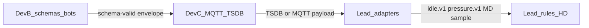

# DevB + DevC — Model plug requirements (Lead handoff)

**Purpose:** Exact deliverables Lead needs from **Vibhanshu (DevB)** and **Chinmay (DevC)** so schemas/bots and MQTT/TSDB plug into Lead model adapters (F02–F06 / HD-graph MD path) **without rewriting demand math**.  
**Owner:** Lead (Dnyandev) — contracts and acceptance.  
**Audience:** DevB, DevC, agents reviewing handoffs.  
**Status:** Active — based on audit of `origin/Vib_branch` (`df51469`) and `origin/chinmay` (`14fc69f`), 2026-08-14.  
**Related:** [`POC_Feature_Specs/INTEGRATION_MODULE_MAP.md`](POC_Feature_Specs/INTEGRATION_MODULE_MAP.md), [`fixtures/demand/INGEST_CONTRACT.md`](../../fixtures/demand/INGEST_CONTRACT.md), [`Layer3_Model_Layer_Technical_Architecture.md`](../architeture/Layer3_Model_Layer_Technical_Architecture.md)

---

## 1. Purpose and ownership split

| Role | Owns | Does not own |
|------|------|----------------|
| **DevB** | 7 family JSON schemas + Day-1 bots/parsers; **wire payload SoT** | MD / leak / ISO math; dashboard |
| **DevC** | Topics, MQTT client, injector, subscriber, TSDB; validate DevB envelopes; later publish Layer3 `_alerts` | Alternate MD formula; schema field invention without DevB |
| **Lead** | Adapters → F02/F04/F05/F06 rules; HD live-window (`demand_window` / `md_risk`); Layer3 event envelopes | Sensor schema drafting; MQTT broker ops |

**Hard rule:** Neither DevB nor DevC reimplements `projected_demand_kva` / 15‑min window math. That stays in Lead / HD-graph formulation ([`HD_graph_Master_Demand_Blueprint.md`](HD_graph_Master_Demand_Blueprint.md)).

---

## 2. Shared telemetry envelope (both must honor)

Every published reading (bot or live) must be expressible as:

| Field | Requirement |
|-------|-------------|
| `device_id` | Present (hardware / gateway id) |
| `timestamp` | ISO-8601 UTC |
| `sensor_type` | Match schema **`const`** (long name, e.g. `electrical_meter`) |
| `schema_version` | **Required** on envelope (add if missing on schemas/bots) |
| `data` | Object; family-specific required keys per `schemas/*.json` |
| `synthetic` | `true` for bots, injectors, CSV replay, public datasets |

### Topic short type ↔ payload `sensor_type` const

Chinmay MQTT topics use **short** `SENSOR_TYPES`. DevB schema `const` values are **long**. **Do not “fix” one to match the other** — keep both; map explicitly.

| Topic segment (`topics.py`) | Payload `sensor_type` (schema const) |
|-----------------------------|--------------------------------------|
| `electrical` | `electrical_meter` |
| `vibration` | `vibration_node` |
| `thermal` | `thermal_probe` |
| `pressure` | `pressure_transmitter` |
| `gas` | `gas_particle_sensor` |
| `stroke` | `digital_pulse_counter` |
| `ambient` | `ambient_weather` |

Topic pattern: `omniview/{site_id}/{node_id}/{short_type}`  
Alerts (Lead → DevC): `omniview/{site_id}/_alerts/{event_type}`

---

## 3. Lead adapter field map (what Lead will consume)

Lead adapters rename wire `data` fields into frozen sample shapes. DevB/DevC keep wire names stable; Lead maps.

| Feature | Spec / contract | Vib / MQTT `data` field(s) | Lead sample field(s) |
|---------|-----------------|----------------------------|----------------------|
| **F02** MD | [`INGEST_CONTRACT.md`](../../fixtures/demand/INGEST_CONTRACT.md), [F02](POC_Feature_Specs/F02_Live_MD_Risk.md) | `apparent_power_kva_total` **or** `active_power_kw_total` + `reactive_power_kvar_total` | `kva` **or** `kw` + `var` |
| **F04** idle | [`idle.v1`](../../Idle-graph/docs/DATA_DICTIONARY.md), [F04](POC_Feature_Specs/F04_Lazy_Idle_Waste.md) | `present_value_pv_c` (thermal), `current_a_avg` (electrical) | `zone_temp_c`, `current_a` |
| **F05** leak | [`pressure.v1`](../../Pressure-graph/docs/DATA_DICTIONARY.md), [F05](POC_Feature_Specs/F05_Compressor_Pressure_Leak.md) | `pressure_bar`, `compressor_state` | `pressure_bar`, `loaded` (`LOADED` → `1`) |
| **F06** vib | [`vibration.v1`](../../Vibration-graph/docs/DATA_DICTIONARY.md), [F06](POC_Feature_Specs/F06_Vibration_ISO_Zones.md) | `z_axis_rms_velocity_mm_sec` (or max of Z/X), `temperature_c` | `rms_velocity_mms`, `surface_temp_c` |

### Edge fields Lead will **not** treat as HD / rule truth

| Field | Why |
|-------|-----|
| `rolling_kva_15min` | Edge approximation; Lead recomputes window integral |
| `md_proximity_percent` | Edge approximation; Lead gates on `projected_demand_kva` vs `contract_demand` |
| `iso_health_zone` on the wire | Optional display only; **OI-58** owns ISO 10816-3 Class II bands |
| Decay rate on pressure wire | Optional; Lead computes decay in `pressure_leak.py` |

### `machine_id` mapping (POC nodes)

Lead rules key on logical assets. DevC node registry (or documented table) must resolve:

| Logical `machine_id` | Typical MQTT `node_id` / role |
|----------------------|-------------------------------|
| `isbm-main-feed` | ISBM electrical + thermal |
| `hp-compressor` | Compressor pressure + vibration (+ electrical as applicable) |

`device_id` may remain hardware-specific (e.g. `Selec-MFM384-01`); adapters map via registry.

---

## 4. What we need from Vibhanshu (DevB)

**Branch reference:** `origin/Vib_branch` — schemas under `schemas/`, bots under `src/omniview/edge/bots/`.

### Checklist

- [ ] Keep all **7** schemas as wire SoT: `electrical`, `vibration`, `thermal`, `pressure`, `gas`, `stroke`, `ambient`. Chinmay already mirrors these files — **any rename/required-key change must be coordinated** with DevC + Lead.
- [ ] Add **`schema_version`** to every schema `required` list and to every bot payload.
- [ ] **Do not delete** [`layer-3:1.ipynb`](../../layer-3:1.ipynb) on merge to main (restore on `Vib_branch` if still deleted vs main).
- [ ] **Electrical:** keep `apparent_power_kva_total` (and/or kw + kvar). Label `rolling_kva_15min` / `md_proximity_percent` as edge informational only in docs or field descriptions.
- [ ] **Thermal + electrical:** keep `present_value_pv_c` and `current_a_avg` for F04 mapping.
- [ ] **Pressure:** keep `pressure_bar` + load signal (`compressor_state` and/or explicit `loaded`). Do not require decay rate on the wire.
- [ ] **Vibration:** keep RMS velocity in **mm/s** (`z_axis_rms_velocity_mm_sec` acceptable). Treat `iso_health_zone` as optional/display — Lead OI-58 owns bands.
- [ ] Deliver **Modbus register map** for MFM384 + SCCT (OI-23 AC) **or** a dated stub explicitly deferring it.
- [ ] Bots remain **schema-valid** (pytest against schemas). Poll: electrical **≤15 s**; physical families **≤60 s**.
- [ ] Prefer sample CSV/JSONL over committing `__pycache__` / large parquet blobs without agreement.
- [ ] Set `synthetic: true` on all bot / replay payloads.

### Done when (DevB)

- Seven schemas + bots validate end-to-end.
- Envelope includes `schema_version`.
- Field names above remain stable enough for Lead adapters in §3.
- Notebook preserved for PdM Stage A extract.

---

## 5. What we need from Chinmay (DevC)

**Branch reference:** `origin/chinmay` — MQTT (`topics`, `mqtt_client`), `injector`, `subscriber`, TSDB, `validation.py` loading `schemas/`.

### Checklist

- [ ] Treat DevB `schemas/` as **validation SoT** in `src/omniview/ingest/validation.py`. Keep files in sync with Vib tip after every schema change.
- [ ] **Align injector** `ELECTRICAL_FIELDS` / synthetic payloads to Vib electrical names (`apparent_power_kva_total`, `active_power_kw_total`, `reactive_power_kvar_total`, `current_a_avg`, …). Legacy names (`kva_total`, `kw_total`, …) **fail** current schemas.
- [ ] Preserve topic hierarchy `omniview/{site}/{node}/{short_type}`; document short ↔ long map (copy §2 table next to `topics.py` or README).
- [ ] **Node registry:** stable lookup MQTT `node_id` / `device_id` → Lead `machine_id` (`isbm-main-feed`, `hp-compressor`). Document or expose for Lead adapters.
- [ ] Subscriber: validate → TSDB; on failure, metric + skip (keep current behavior). Update mock payloads in tests when schemas tighten.
- [ ] Accept Layer3 event envelopes on `omniview/{site}/_alerts/{event_type}` **without rewriting** Lead payload field names ([Layer3 §3–5](../architeture/Layer3_Model_Layer_Technical_Architecture.md)).
- [ ] **Do not** recompute MD / leak / ISO zones in the edge injector — pipe only.
- [ ] Day-1 demo path: bot or injector → MQTT → TSDB (or export) readable for Lead offline adapter.
- [ ] Injectors / synthetic path: `synthetic: true`.

### Note on DevC “waiting on DevB” checklist

`Docs/DevB_Schema_Integration_Checklist.md` on Chinmay’s branch assumed schemas were not ready. **Schemas are now present.** Next DevC actions: injector rename, test payload compliance, node registry for `machine_id` — not “wait for schemas.”

### Done when (DevC)

- Injector payloads validate against current DevB electrical schema.
- Short topic types + long payload consts coexist per §2.
- `machine_id` mapping documented.
- Alert topic ready for Lead event JSON.

---

## 6. Joint acceptance (Lead + both)

Plug is accepted when **all** of the following hold:

| # | Criterion |
|---|-----------|
| 1 | One electrical bot/MQTT payload validates against Vib schema **and** maps through a Lead adapter into `run_series` → `md_risk` (same behavior as near-miss fixture: alert by ~T=11 when projected ≥ contract). |
| 2 | Idle path: thermal + electrical ticks supply `zone_temp_c` + `current_a` after adapter (`idle.v1`). |
| 3 | Pressure path: `pressure_bar` + `loaded` available for `pressure_leak`. |
| 4 | Vib path: `rms_velocity_mms` mappable for OI-58. |
| 5 | No alternate MD formula on edge (confirmed by both developers). |
| 6 | Honesty: bots/injectors remain `synthetic: true` until bottle organic capture. |

Proof today (Lead tree, offline):  
`.venv/bin/python scripts/demo_md_risk.py --data near-miss`

---

## 7. Explicit non-requests

| Do not | Why |
|--------|-----|
| Build F03 day-ahead inside DevB/DevC | Lead / HD-graph extract per [`Demand_Supply_Layer_Plan.md`](Demand_Supply_Layer_Plan.md) |
| Auto-actuate equipment | HITL only (PRD) |
| Present campus / heta / public datasets as bottle organic | Honesty rule |
| Fork HD live-window math in injector or bot | AGENTS.md hard rule 1 |
| Merge schema renames without Lead + other side | Breaks adapters and validation |

---

## 8. Traceability (Jira)

| Owner | Keys | Focus |
|-------|------|--------|
| DevB | OI-23, OI-5, OI-6, OI-7, OI-2, OI-8 | Schemas, bots, Modbus map, umbrella |
| DevC | OI-51, OI-54, OI-12 (injector), OI-68/69 UI later | MQTT, TSDB, pipe, dashboard |
| Lead | OI-56, OI-57, OI-58, OI-59, OI-62 | MD, idle, vib zones, leak, PdM A |
| Contracts | OI-42 | Layer3 event envelope |
| Site truth | OI-43 | Sanctioned `contract_demand` |

Person ownership overview: [`Docs/OI_Sprint_Planning_Person_Ownership.md`](../OI_Sprint_Planning_Person_Ownership.md).

---

## 9. Document control

| Item | Value |
|------|--------|
| Created | 2026-08-14 |
| Author | Lead |
| Update when | Schema field rename, topic map change, or new `machine_id` |
| Supersedes | Informal “waiting on DevB schemas” only — not Layer3 or ingest contracts |
