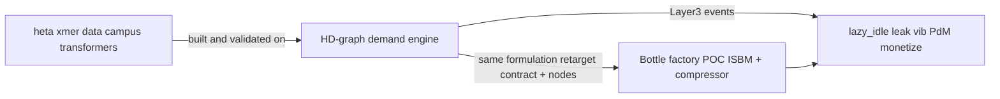

# HD-graph Master Demand Blueprint — Bottle Factory POC

**Status:** Master blueprint for OmniView demand calculation and prediction  
**Target client / site:** ISBM-PET **bottle manufacturing** factory, Pune (MSEDCL HT-I)  
**Nodes in scope:** HP compressor (25–40 bar) + ISBM main electrical feed  
**Do not invent alternate MD math** — follow this document and the HD-graph sources it cites.

| Artifact | Role |
|----------|------|
| [`heta xmer data for ai /`](../../heta%20xmer%20data%20for%20ai%20/) | Development corpus — campus transformer CSVs used to **build and prove** the engine |
| [`HD-graph/`](../../HD-graph/) | The **already-built** max-demand calculation + prediction engine |
| OmniView IQ (this repo) | **Bottle factory** deployment — same formulation, new assets / contract / live meters |

**Heta data ≠ bottle factory data.** Demos that replay heta streams or injectors must set `synthetic: true` (or equivalent disclosure). Never present campus predictions as this plant’s organic capture.

**Companion contracts:** [`../architeture/Layer3_Model_Layer_Technical_Architecture.md`](../architeture/Layer3_Model_Layer_Technical_Architecture.md)  
**Product claims:** [`../../OmniView_IQ_POC_Plan_PRD_and_Architecture.md`](../../OmniView_IQ_POC_Plan_PRD_and_Architecture.md)

---

## 1. North star

1. Reuse HD-graph **terminology and formulations** for demand in OmniView.
2. Plug the demand module into Layer 3 so **every other POC function still works** (lazy-idle, leak, vib, PdM, monetize, action cards, jumbo, HITL).
3. Client story at the bottle plant: live billing-window MD risk **and** 96-slot day-ahead demand plan — plus the rest of the POC around that spine.



---

## 2. Transfer model: campus → bottle factory

| Layer | Campus (heta / HD-graph) | Bottle factory (OmniView POC) |
|-------|--------------------------|-------------------------------|
| Site story | Hospital / College / Hostel transformers | **ISBM-PET line** — HP compressor + ISBM main feed |
| Contract | e.g. 500 / 800 kVA nameplates in HD PRD | `contract_demand` / `CONTRACTED_DEMAND_KVA` from **OI-43** (placeholder until bills confirmed) |
| Electrical source | CSV replay ~2 min | Selec MFM384 + CTs → edge → MQTT (≤15 s); fixtures until live |
| Live window | `PowerMonitor` | Same formulas → `md_risk` on bottle `machine_id`s |
| Day-ahead 96 slots | Slot models on heta history | Same method; retrain/transfer when bottle history exists; until then heta/fixtures with disclosure |
| Generator mix G1–G4 | Campus-specific | **Out of bottle POC** |
| Co-sensors | Mostly electrical | Electrical **plus** thermal / vib / pressure / stroke for other FRs |

### Bottle factory `machine_id` conventions (POC)

| `machine_id` | Physical node |
|--------------|---------------|
| `isbm-main-feed` | Main electrical feed of the ISBM machine |
| `hp-compressor` | High-pressure compressor node |

Use these (or DevC’s final node registry names) consistently in events and fixtures. Do not use Hospital/College/Hostel consumer names in bottle-facing demos.

### 2.1 Orchestration vs pluggable ingest (POC order)

**POC hero first:** live-window Max Demand (`md_risk`). Other FRs (PdM, lazy-idle, leak) stay in the tree but are **not** the current show.

OmniView-L3 is **orchestration + intelligence**, not the full acquisition stack:

| Layer | Owns | Now | Later (plug, do not rewrite MD math) |
|-------|------|-----|--------------------------------------|
| Acquisition | Ticks in | Local CSV / JSON fixtures | MQTT / edge (DevC + DevB bots) |
| Orchestration | Wire ingest → rules → events | `omniview.rules` + `scripts/demo_md_risk.py` + explorer API | Same `run_series` / `evaluate_md_risk` |
| Intelligence | HD live-window MD | `demand_window.py` + `md_risk.py` | Site `contract_demand` from OI-43 |
| Surface | HITL | CLI + MD-first explorer | DevC dashboard consumes `md_risk` |

**Ingest contract (frozen):** [`../../fixtures/demand/INGEST_CONTRACT.md`](../../fixtures/demand/INGEST_CONTRACT.md) — MQTT adapter must emit the same sample dicts CSV replay already produces.

```text
CSV or MQTT ticks  →  DemandWindowState.update / run_series  →  md_risk  →  HITL
```

Do not install MQTT as a blocker for MD proof. Prove on CSV (HD-graph style), then swap acquisition.

---

## 3. Dual engines (reuse both)

| Engine | HD source | Bottle-factory client story |
|--------|-----------|------------------------------|
| **Live 15‑min window** | [`HD-graph/webapp/backend/power_monitor.py`](../../HD-graph/webapp/backend/power_monitor.py) | “Will **this** billing window breach **our** contracted MD?” (FR3–FR4) |
| **Day-ahead 96-slot** | [`energy_model.py`](../../HD-graph/webapp/backend/energy_model.py), [`features_service.py`](../../HD-graph/webapp/backend/features_service.py), [`MERC_Strategy_Blueprint.md`](../../HD-graph/docs/MERC_Strategy_Blueprint.md) | “Tomorrow’s slot-by-slot demand plan” (24h forecast) |
| **Slot prep** | [`HD-graph/preprocessing.py`](../../HD-graph/preprocessing.py) | Shared `avg_kva` / `max_kva` / `kvah_consumption` / `slot_of_day` |

### 3.1 Live window formulation

1. `kva_instant = √(kW² + VAR²)` (or use meter `VA` / kVA when already apparent)
2. `accumulated_kva_minutes += kva_instant * Δt_minutes` (HD demo used Δt=2; bottle POC uses actual poll Δt ≤15 s)
3. Window close: `avg_demand_kva = accumulated_kva_minutes / 15`
4. Mid-window: `projected_demand_kva = (accumulated_kva_minutes + kva_instant * time_remaining) / 15`
5. `session_peak_demand = max(session_peak, closed-window avg)`
6. `limit_line_value = contract_demand * T_minutes`
7. **OmniView addition:** emit `md_risk` when projected trajectory vs `contract_demand` warrants alert with ≥4 min lead (target ~**minute 11** of the 15‑min window)

### 3.2 Day-ahead formulation

1. Aggregate history to 15‑min slots (`slot_of_day` 0..95)
2. Target column: `kvah_consumption` (HD production path)
3. **96 slot-specific** XGBoost models, objective quantile **0.75**
4. Features from ground-truth history only (no recursive “ghost” predictions)
5. Post-process: `predicted × 1.02` safety buffer
6. Simulation alert: `IF actual[slot] > predicted[slot] → DEMAND_EXCEEDED`
7. Preserve outliers in training — peak days drive penalty risk

### 3.3 Slot prep formulation (`aggregate_to_15min`)

- Resample ~2‑min (or finer) rows → fixed 15‑min bins
- `avg_kva` / `max_kva` from `VA_total` mean/max (÷1000 when raw is VA)
- `kvah_consumption` = Δ(`VAh_Received`)/1000, else fallback `avg_kva * 0.25`
- Time features: `hour`, `minute`, `dayofweek`, `month`, `is_weekend`, `slot_of_day`

**Bridge identity:** for a 15‑min slot, `avg_kva ≈ 4 × kvah_consumption`. Live alerts speak **kVA**; day-ahead schedule speaks **kVAh per slot** — same physics, two product surfaces. OmniView keeps HD names for both.

---

## 4. Terminology dictionary (adopt in OmniView)

| HD term (use this) | Physical meaning | Formula / note |
|--------------------|------------------|----------------|
| `VA_total` | Instantaneous apparent power (often VA) | ÷1000 → kVA in preprocessing |
| `kW_Total` | Active power | With VAR → kVA |
| `VAR_Total` | Reactive power | Required for apparent demand |
| `PF_Ave` | Power factor | Explains kW vs kVA gap |
| `VAh_Received` → `KVAH_Total` | Cumulative apparent energy | Diff → consumption |
| `avg_kva` | Mean demand in 15‑min slot | `mean(VA_total)/1000` |
| `max_kva` | Peak sample in slot | Not billing MD alone |
| `kvah_consumption` | Slot energy (**ML target**) | `ΔVAh/1000` or `avg_kva × 0.25` |
| `slot_of_day` | 0..95 | `hour*4 + minute//15` |
| `predicted_max_kvah` / `Predicted_Energy_KVAH` | Day-ahead slot prediction | Q75 × 1.02 |
| `contract_demand` | Contracted MD limit | Config / OI-43 |
| `accumulated_kva_minutes` | Window integral | `Σ(kva × Δt_min)` |
| `projected_demand_kva` | End-of-window forecast | `(accum + kva×remaining)/15` |
| `session_peak_demand` | Running max of window avgs | Session peak proxy |
| `T_minutes` | Minutes into current window | Lead-time / minute-11 |
| DSM `Penalty` | Schedule deviation ₹ | 10/15/20% bands — label clearly; not MD surcharge table |

---

## 5. Value importance map

Apparent demand is the product claim: **kVA / kVAh**, not kW alone. Bottle-factory teaching point: **compressor + heater overlap** is a classic MD near-miss the live engine must catch.

### 5.1 Raw meter values

| Value | Why it matters | Used for |
|-------|----------------|----------|
| `Date_time` | Aligns slots to utility 15‑min calendar; clock drift kills MD math | Slotting, lags, window start |
| `kW_Total` | Real work draw; active component of demand | `kva = √(kW²+VAR²)`; idle detection cousin |
| `VAR_Total` | Reactive load; demand is **apparent** | Same kVA — ignoring VAR understates MD |
| `VA_total` | Direct apparent power when present | Slot `avg_kva` / `max_kva` |
| `PF_Ave` | Poor PF inflates demand for same work | Features, diagnostics, monetize context |
| `VAh_Received` | True slot energy without approximating | `kvah_consumption` ML target |
| `Current_*` / `Voltage_*` | Cross-check, imbalance, quality | PdM / quality — not primary MD target |
| `Frequency` | Grid health | Secondary |

### 5.2 Slot-derived values

| Derived | Importance for prediction |
|---------|----------------------------|
| `slot_of_day` | Micro-pattern key — 3 AM ≠ 10 AM; one model per slot |
| `avg_kva` | Slot demand level; linked to energy via ×0.25 |
| `max_kva` | Intra-slot spikes (peak/penalty days) |
| `kvah_consumption` | Production day-ahead ML target |
| `lag_1d` / `lag_7d` | Same slot yesterday / last week |
| `rolling_mean_24h` / `rolling_max_24h` | Recent regime (base vs peak day) |
| `is_holiday` | Load regime shift (festivals, shutdowns) |
| `forecast_temp_max` / humidity | Cooling / ambient load driver (retarget lat/lon to Pune when live) |

### 5.3 Live window values

| Live value | Importance |
|------------|------------|
| `accumulated_kva_minutes` | Time-weighted integration — billing MD spirit |
| `projected_demand_kva` | Early warning before window locks |
| `contract_demand` | Breach threshold (OI-43) |
| `T_minutes` | Enables ~minute‑11 lead-time trigger |
| `session_peak_demand` | Session peak for dashboard / proof |

### 5.4 Day-ahead strategy rules (why)

| Rule | Why |
|------|-----|
| Direct multi-step (96 independent preds) | Avoids recursive ghost-data drift |
| 96 slot-specific models | Slot micro-physics |
| Ground-truth lags only | Clean features |
| Quantile 0.75 | Prefer slight over-predict — under-predict costs more |
| ×1.02 safety buffer | Hedge vs danger band |
| Preserve outliers | Peak days are when penalties hurt |
| Holiday + weather | Regime shifts |

---

## 6. POC representation coverage

Demand engine fulfills the **MD / forecast spine**. It must not orphan other POC functions.

### 6.1 PRD goals / FRs / heroes

| POC item | Role of HD demand engine | Other module that must still work | Demo now? | Needs site data? |
|----------|--------------------------|-----------------------------------|-----------|------------------|
| Goal: MD near-miss detectable | Live window + `md_risk` | OI-50 MD fixture; OI-43 contract | Yes (fixtures / heta labeled) | Real capture: OI-79 |
| Goal: phantom-run / idle ₹ | Not demand’s job | Electrical baseline + monetize | Partial | Changeover window on site |
| Goal: lazy-idle flag | Shared `electrical` only | Thermal + `lazy_idle` (FR5) | Yes (OI-50) | Organic or disclosed test |
| FR1–FR2 poll cadence | Consumes electrical stream | Edge / DevC | Scaffold | Live install |
| FR3–FR4 rolling MD + lead time | **Demand engine core** | — | Yes | Live cutover OI-78 |
| FR5 lazy-idle | Independent | OI-57 | After OI-50 | — |
| FR6 pressure leak | Independent | OI-59 | After OI-50 | — |
| FR7 offline buffer | Unaffected | Edge gateway | DevC | Site network |
| FR8 dashboard + action card | Consumes demand + other events | DevC UI + arbitration | When events flow | — |
| Hero: live kVA vs contract | Live engine | Jumbo display | Yes | Live meter |
| Hero: penalty avoided ₹ | Monetize on `md_risk` | OI-70 | Placeholder OK | OI-43 bills |
| Hero: kWh / 1000 bottles | Needs stroke + energy | Stroke / counter | Later | Site stroke |
| Hero: high-waste idling % | Not day-ahead ML | Idle rules / baseline | Fixtures | Site idle window |
| Success: real MD near-miss | Live engine | Install OI-78/79 | After install | Yes |
| HITL / no auto-actuate | Recommend only | Arbitration / What-If | Always | — |
| Non-goal RUL B–C / multi-site | Keep out | PdM Stage A only | Stage A path | — |

### 6.2 Broader POC-features stance

| Feature cluster | Bottle POC stance with HD engine |
|-----------------|----------------------------------|
| Six-layer / edge / offline | Unchanged; demand sits in Layer 3+ |
| 24h demand forecasting / XGBoost | **= HD day-ahead engine** — do not reinvent |
| Real-time deviation / waste | Live MD + lazy-idle + leak + vib |
| Load-curve flattening / peak shaving | Action cards from `md_risk` / forecast — **recommend**, don’t auto-shed |
| Digital twin / FMI sandbox | Offline playbook authoring; live What-If stays bounded |
| dMRV / blockchain / ISO 14064 | Aspirational — **not** blocking bottle MD demo |
| Jumbo display + alert matrix | Live kVA / MD warnings from demand module |
| Multi-tenant / HDID | Platform; demand math is tenant-agnostic |

### 6.3 Still-works rule (when demand is plugged in)

- Other rules keep evaluating on the same poll cycle.
- Arbitration merges concurrent events (e.g. critical vib + MD risk) into one action card.
- Monetize prices MD risk without owning prediction math.
- PdM HI may read electrical history but emits `maintenance_risk`, not `md_risk`.
- Scenario injector can fire MD / lazy-idle / leak independently.
- Demand module must not mutate telemetry or block other evaluators.

---

## 7. Pluggable Layer 3 I/O

Full field freeze: [`../architeture/Layer3_Model_Layer_Technical_Architecture.md`](../architeture/Layer3_Model_Layer_Technical_Architecture.md).

| `event_type` | Engine | Notes |
|--------------|--------|-------|
| `md_risk` | Live window | HD field names in payload; ~min 11 vs `contract_demand` |
| `demand_forecast` | Day-ahead 96-slot | `predicted_max_kvah` / slots; optional actual + penalty for sim |

**Inputs:** electrical `kW`/`VAR` or `VA`/`kVA` + timestamp; normalize VA÷1000 as in HD preprocessing.  
**Synthetic:** heta replay or OI-50 injector → `synthetic: true`.  
**Campus-only (do not force into bottle POC):** Hospital/College/Hostel rollup, G1–G4 solar/DG mix UI.

---

## 8. Ticket map

| Key | Demand-related expectation |
|-----|----------------------------|
| OI-42 | Contracts include demand events (done + this blueprint) |
| OI-43 | Bottle `contract_demand`, bills, nameplates — honest ₹ / MD threshold |
| OI-50 | MD near-miss fixtures use HD field names + bottle `machine_id`s |
| OI-56 | Implement live window math from this blueprint → `md_risk` |
| OI-70 | Monetize `md_risk` (and optionally labeled DSM bands on forecast sim) |
| OI-78 | Live Modbus cutover feeds demand module |
| OI-79 | Capture real MD near-miss / idle / lazy-idle on bottle site |
| OI-80 | PRD §7 acceptance including MD math validation |

Day-ahead `demand_forecast` can demo on labeled heta/fixtures before bottle history exists; retrain when site history is sufficient.

---

## 9. Implementation order (after this blueprint)

1. Extract pure functions (slot aggregate, live window, feature builder) into pluggable `omniview` demand package.
2. OI-56 `md_risk` on bottle-shaped fixtures (HD math).
3. Demo path: heta replay and/or fixtures → `demand_forecast` with disclosure.
4. Cutover live bottle Modbus (OI-78); real events (OI-79); §7 (OI-80).
5. Retarget weather lat/lon to Pune; set `contract_demand` from OI-43.

---

## 10. Source index

| Path | Use |
|------|-----|
| `HD-graph/webapp/backend/power_monitor.py` | Live window math |
| `HD-graph/preprocessing.py` | 15‑min aggregation + kVA/kVAh |
| `HD-graph/webapp/backend/energy_model.py` | 96-slot train/predict, penalty, buffer |
| `HD-graph/webapp/backend/features_service.py` | Lags, holiday, weather, feature columns |
| `HD-graph/docs/MERC_Strategy_Blueprint.md` | Q75 / buffer / direct multi-step rationale |
| `HD-graph/PRD_Energy_Management_System.md` | Original HD product requirements |
| `heta xmer data for ai /` | Engine development CSVs (gitignored) |

---

*Master blueprint for bottle-factory demand. Change control: update this file and Layer3 contracts together; notify DevB/DevC when field names or `event_type`s change.*
