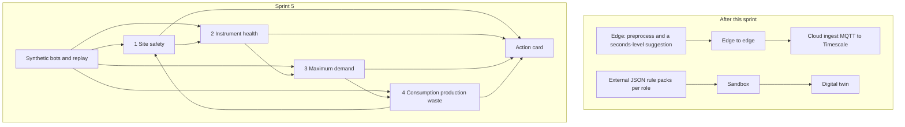

# HLD — Four core features, one attached system

**Status:** Accepted for Sprint 5  
**Date:** 26 October 2026  
**PRD:** [PRD_Four_Core_Features.md](PRD_Four_Core_Features.md)  
**LLD:** [LLD_Four_Core_Features.md](LLD_Four_Core_Features.md)

## 1. Decision

The six sensor designs stay as data contracts. The product surface is four features. Each feature reads another feature’s result. The suggestion a person sees is an action card. The card never actuates.

The platform that comes after this sprint is a separate box: external rules, the communication line, a sandbox, and a digital twin. It is drawn here so the sprint does not absorb it.

## 2. System



Sprint 5 feeds the four features from bots and replay. It does not wait for the live edge path.

## 3. What each feature exchanges

| From | Result passed on | Consumed by |
|---|---|---|
| Site safety | Waste, fire, thermal spike, insulation break | Health, as context that the machine is not in a normal thermal state |
| Instrument health | Service due, breakdown risk, high consumption, cooling malfunction | Maximum demand, which lowers tomorrow’s energy when a machine will be down |
| Maximum demand | Slot plan, fine placeholder, numbered suggestions | Consumption and waste, which picks run hours inside that plan |
| Consumption and waste | Production rate, idle waste, stop hour | Site safety (consumption against production) and health (daily output) |

Pressure and cooling enter feature 4 only. Gas enters feature 1 only, as a reading.

## 4. Where the logic lives

| Place | Sprint 5 role | Existing code |
|---|---|---|
| Edge bots | Synthetic stand-in for the sensor, marked synthetic | `src/omniview/edge/bots/` — `ambient_bot`, `electrical_bot`, `gas_bot`, `thermal_bot`, `vibration_bot`, `pressure_bot`, `stroke_bot` |
| Cloud rules | The four features | `src/omniview/rules/` |
| Action card | The only output a person sees | `ActionCardGenerator` in `action_cards.py` |
| Demand math | Live window and 96-slot forecast | `demand_window.py`, `md_risk.py`, and the HD-graph day-ahead engine cited by the demand blueprint |
| Health math | Stage A only | `predict_maintenance_risk` and `run_stage_a_pipeline` |

There is no `ambient_correlation` module and no `stroke_jam` module in this tree. The HLD does not assume them. Feature 1’s temperature-and-power link and feature 4’s schedule are new composition on top of the bots and the rules that do exist.

## 5. Feature shape

### Site safety

Correlate three streams that already have bots: ambient, electrical, gas. Thermal state comes from `thermal_bot`. The outputs are suggestions. SSR and MCB status is an input field on the electrical stream. Until a real status bit exists, the synthetic bot carries it and the card says so.

### Instrument health

Vibration pattern is `evaluate_vibration_zone`. The zone table is a placeholder until the nameplate class is confirmed. Health prediction is Stage A, unchanged. The new comparison is energy high while cooling temperature is low. That comparison reads feature 4’s cooling input and the electrical meter. It does not add a second health index.

### Maximum demand

Two clocks.

- Now: `DemandWindowState` and `evaluate_md_risk` at minute 11. Contract kVA is `get_contract_demand_kva()` and is still a placeholder.
- Tomorrow: 96 slots from the HD-graph day-ahead engine (`HD-graph/webapp/backend/energy_model.py`). Same formulation. No second model. Campus history used to run it is synthetic. If health says a machine will be down, that slot’s predicted energy is reduced by that machine’s known share. The share stays a labeled input, not a new formula.

Fines on the card use the existing rupee line and stay placeholder until OI-43.

### Consumption, production, and waste

`evaluate_lazy_idle` is the idle-waste detector. `evaluate_pressure_leak` is the loaded-line waste input. Stroke count from `stroke_bot` is the production rate. The schedule report is the composition: health says what must be serviced, demand says the energy plan, lazy-idle and pressure say where the waste is, stroke rate says which hour produced more. The report recommends a run hour and a stop hour.

## 6. Suggestion path

```text
rule event → ActionCardGenerator.generate_card → one card
```

Priority when two features speak at once stays the existing order from F09: safety, then compliance, then cost. That arbitration is OI-60 and is **not** in Sprint 5. Until it lands, each feature emits its own card and does not cancel another feature’s card.

## 7. Out of this diagram’s sprint box

| Later piece | What it adds |
|---|---|
| External rule engine | A JSON pack per role. The engine evaluates the pack against the four outputs. |
| Communication line | Sensor to edge, preprocess, a suggestion inside seconds, forward it, then edge-to-edge, then MQTT to Timescale. |
| Sandbox | Apply one suggestion to a snapshot and show the effect. This is not a general physics simulator. |
| Digital twin | The visual of the four features. A sandbox result updates it. |

## 8. Constraints carried from the repo

- Human in the loop only.
- Do not invent a second max-demand or 96-slot formulation.
- Do not invent a second Stage A health formula.
- `synthetic: true` on bots, injectors, and public or campus datasets.
- Topic short type and payload `sensor_type` stay mapped, not collapsed. See [DevB_DevC_Model_Plug_Requirements.md](DevB_DevC_Model_Plug_Requirements.md).
