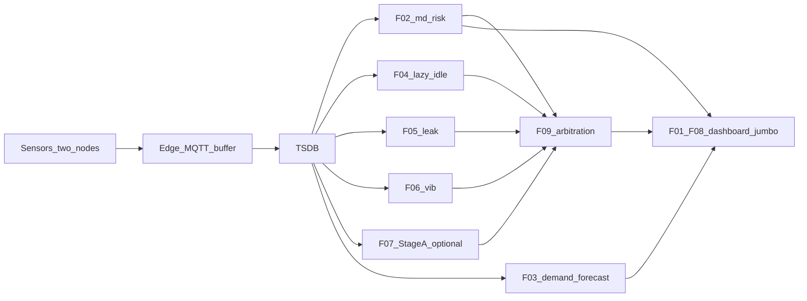

# Integration module map — Bottle Factory POC

**Purpose:** Show which feature plugs into which layer/module, what events flow, and the recommended build order.  
**Scope:** Two nodes (`isbm-main-feed`, `hp-compressor`), HITL only.  
**Index:** [README.md](README.md)

---

## 1. End-to-end wiring

**Pluggable ingest (F02 / F03):** CSV or fixture today → same sample/history shape → MQTT/TSDB later. See `fixtures/demand/INGEST_CONTRACT.md`.

---

## 2. Feature → module → event → UI

| Feature | Produces | Consumes from | UI surface | Code / module path (today or planned) |
|---------|----------|---------------|------------|----------------------------------------|
| **F01** Live monitor + dashboard/jumbo | Live series views | MQTT/TSDB latest + Layer3 events | Dashboard, jumbo | DevC OI-68/72; pipe OI-51/54; consumption map: [`F01_CONNECTOR.md`](F01_CONNECTOR.md) |
| **F02** Live MD | `md_risk` | Electrical ticks (ingest contract) | Heroes, action card | `src/omniview/rules/demand_window.py`, `md_risk.py`; fetch boundary: [`Demand_Supply_Layer_Plan.md`](../Demand_Supply_Layer_Plan.md) |
| **F03** Day-ahead 96-slot | `demand_forecast` | Historical electrical slots | Optional forecast chart | HD-graph extract → `omniview` demand package (planned); fetch boundary: [`Demand_Supply_Layer_Plan.md`](../Demand_Supply_Layer_Plan.md) |
| **F04** Lazy-idle | idle/waste event | Temp + current | Waste hero, card | `src/omniview/rules/lazy_idle.py` (OI-57); data pack: [`Idle-graph/`](../../../Idle-graph/) (`idle.v1`, ziya07/sensor-maintenance-dataset) |
| **F05** Pressure leak | leak proxy event | Pressure + load context | Leak card | `rules/pressure_leak.py` (OI-59); data pack: [`Pressure-graph/`](../../../Pressure-graph/) (`pressure.v1`, MetroPT-3) |
| **F06** Vib ISO zones | vibration zone event | RMS velocity | Zone badge, card | Planned `rules/` vib (OI-58); data pack: [`Vibration-graph/`](../../../Vibration-graph/) (`vibration.v1`, dataset TBD) |
| **F07** Anomaly bundle | Union of above ± `maintenance_risk` | F02–F06 (+ Stage A) | Anomaly list | Composed; Stage A: `predictive_maintenance.py`; composition map: [`F07_CONNECTOR.md`](F07_CONNECTOR.md) |
| **F08** Thin live twin | Asset status model | TSDB latest + alerts | Status cards | Same as F01 dashboard layer; status-source map: [`F08_CONNECTOR.md`](F08_CONNECTOR.md) |
| **F09** Conflict what-if | Single action card | Concurrent Layer3 events + snapshot | Action card UI (OI-69) | Planned arbitration (OI-60); event-source + playbook map: [`F09_CONNECTOR.md`](F09_CONNECTOR.md) |

---

## 3. Integration build order

| Step | Features | Why |
|------|----------|-----|
| 1 | **F02** | Hero MD brain; offline CSV proof |
| 2 | **F01 + F08** pipe | Surface for humans; thin status |
| 3 | **F04, F05, F06** | Remaining Must detectors |
| 4 | **F07** | Bundle + tests (OI-61); Stage A optional |
| 5 | **F09** | Arbitration once multiple events exist |
| 6 | **F03** | Day-ahead after live MD path solid |

Site cutover (OI-78–80) swaps ingest to live Modbus without rewriting F02 math.

---

## 4. Layer ownership (solo or team)

| Layer | Modules | Owner (if split) |
|-------|---------|------------------|
| Sense / edge / MQTT / TSDB / dashboard / jumbo | F01, F08 pipe | DevC — see [`../DevB_DevC_Model_Plug_Requirements.md`](../DevB_DevC_Model_Plug_Requirements.md) §5 |
| Schemas / Day-1 bots | Inputs to all | DevB — see [`../DevB_DevC_Model_Plug_Requirements.md`](../DevB_DevC_Model_Plug_Requirements.md) §4 |
| Rules / MD / PdM A / arbitration contracts | F02–F07, F09 | Lead |
| Site contract MD | Config for F02 | Lead + finance (OI-43) |

**Handoff SoT (field maps, envelope, joint acceptance):** [`../DevB_DevC_Model_Plug_Requirements.md`](../DevB_DevC_Model_Plug_Requirements.md).

If solo: same order; use CSV until meters live.

---

## 5. Explicit non-integrations (POC)

Do **not** wire into this POC map:

- Campus Hospital/College/Hostel rollup or G1–G4 generator sim  
- Full FMI digital twin / “simulate any scenario” sandbox  
- Carbon / blockchain / dMRV registry path  
- Enterprise multi-tenant RBAC as a blocking dependency  
- Auto load-shed or closed-loop actuation  

---

## 6. Done when (integration)

- Every Must feature has a row in §2 with event + UI target  
- Build order §3 followed for demos  
- Ingest contract shared by CSV and future MQTT for F02  
- Client pitch matches [README.md](README.md) nine specs — not marketing overclaim

---

## 7. Future orchestration layer

Today F01/F07/F08/F09 each document their own upstream sources ([`F01_CONNECTOR.md`](F01_CONNECTOR.md), [`F07_CONNECTOR.md`](F07_CONNECTOR.md), [`F08_CONNECTOR.md`](F08_CONNECTOR.md), [`F09_CONNECTOR.md`](F09_CONNECTOR.md)) and fetch from them independently — this is intentional for now, matching how few of those sources are live.

**Not yet:** a single orchestration/connector service. Build one only once F02 (done), F04/F05/F06 (Idle-graph/Pressure-graph/Vibration-graph adapters + rules), and Stage-A PdM all emit real Layer3 events — live or fixture-replay. At that point the four connector docs above become that service's spec input: same sources, same aggregation logic, collapsed into one fetch layer instead of four independent ones.

No code for this in the current slice — a pointer only, so the eventual build has a fixed starting spec instead of re-deriving source lists from scratch.

---

## 8. SiteProfile → demo enablement

Composition UIs light panels from `enabled_detectors` / `ui.owner_dashboard_screens` on the loaded SiteProfile ([`../Base_Core_Site_Profile_ADR.md`](../Base_Core_Site_Profile_ADR.md)). Family packs stay the deep lab. There is **no** universal runtime model.

| Detector (`enabled_detectors`) | Pack (plug-in) | Owner-dashboard screen |
|--------------------------------|----------------|-------------------------|
| `md_risk`, `demand_forecast` | HD-graph (pack pattern) + Lead `md_risk` | `power` |
| `pressure_leak` | Pressure-graph | `pressure` |
| `lazy_idle` | Idle-graph | `idle` |
| `vibration_zone` | Vibration-graph | (later vib screen) |
| `maintenance_risk` | `predictive_maintenance.py` | events / overview |

`overview`, `correlation`, and `events` stay on when two or more families are enabled. Hospital engine-dev profile enables `md_risk` / `demand_forecast` only — do not show pressure leak or run OI-59 on chillers.

Code: `omniview.config.detector_enabled` / `SiteProfile.owner_dashboard_screens()`. Owner-dashboard nav wiring from those helpers is a follow-up; this table is the contract.
