# OmniView IQ — Low-Level Architecture & Design (LLD)

**Document Identifier:** `OI-LLD-2026-V1`  
**Site:** ISBM-PET Bottle Manufacturing, Pune (MSEDCL HT-I)  
**Author:** Auto-generated from live codebase inspection — October 2026  
**Companion documents:**  
- [`OmniView_IQ_POC_Architecture_High_and_Low_Level.md`](./OmniView_IQ_POC_Architecture_High_and_Low_Level.md) — HLD overview  
- [`OmniView_IQ_Master_High_Level_Design.md`](../../OmniView_IQ_Master_High_Level_Design.md) — Master HLD (6-layer)  
- [`OmniView_IQ_POC_Plan_PRD_and_Architecture.md`](../../OmniView_IQ_POC_Plan_PRD_and_Architecture.md) — PRD & Plan

---

## 1. System Overview — Package Topology

The `omniview` Python package is structured into 5 sub-packages plus a centralized config module, mapping directly to the 6-layer architecture:

```
omniview/                          ← Root package (__version__ = "0.1.0")
│
├── config.py                      ← Layer 0: Centralized .env → typed constants
│
├── edge/                          ← Layers 1–2: Sense + Connect
│   ├── poller.py                  ← Physical sensor polling daemon (OI-13)
│   ├── mqtt_client.py             ← MQTT pub/sub with offline resilience (OI-51)
│   ├── topics.py                  ← Topic hierarchy contract (OI-51)
│   ├── node_registry.py           ← Device/node map for Pune POC (OI-51)
│   ├── device_config.py           ← edge_nodes.json loader (OI-52)
│   ├── injector.py                ← CSV → MQTT electrical replay (OI-12)
│   ├── offline_buffer.py          ← SQLite offline cache (OI-28)
│   ├── buffer_replay.py           ← Chronological replay engine (OI-29)
│   ├── ntp_guard.py               ← NTP drift monitor + alert (OI-53)
│   ├── modbus_stub.py             ← Modbus RTU stub for hardware cutover (OI-13)
│   ├── anomaly_detector.py        ← Cross-family statistical anomaly detector
│   ├── safety_signoff.py          ← Installation safety sign-off workflow
│   ├── install_procedure.py       ← Non-invasive installation procedure
│   ├── site_profile.py            ← Factory site profile (Layer 0 data)
│   ├── bom.py                     ← Bill of Materials tracker
│   ├── parsers/                   ← 7 sensor data parsers (DevB schemas)
│   │   ├── modbus_parser.py
│   │   ├── vibration_parser.py
│   │   ├── thermal_parser.py
│   │   ├── pressure_parser.py
│   │   ├── gas_parser.py
│   │   ├── stroke_parser.py
│   │   └── ambient_parser.py
│   └── bots/                      ← 7 live edge simulators (DevB)
│       ├── electrical_bot.py
│       ├── vibration_bot.py
│       ├── thermal_bot.py
│       ├── pressure_bot.py
│       ├── gas_bot.py
│       ├── stroke_bot.py
│       └── ambient_bot.py
│
├── adapters/                      ← Cross-cutting: Schema Translation
│   └── wire.py                    ← DevB → Lead field name adapter (OI-54/C4)
│
├── ingest/                        ← Layer 3 (part 1): Cloud Ingestion & Storage
│   ├── db.py                      ← TimescaleDB engine, hypertables, upserts (OI-54)
│   ├── migrations.py              ← Idempotent startup DDL runner (OI-54)
│   ├── subscriber.py              ← MQTT → TSDB bridge process (OI-54)
│   ├── tsdb_inserter.py           ← High-level insert facade (OI-15)
│   ├── validation.py              ← JSON schema validation (OI-14)
│   ├── backfill_coordinator.py    ← Cloud-side backfill + gap verification (OI-29)
│   └── seed.py                    ← Day-1 hybrid dataset loader (OI-55)
│
├── rules/                         ← Layers 3–4: Rule Engine & Intelligence
│   ├── demand_window.py           ← F02: 15-min MD risk detector
│   ├── lazy_idle.py               ← F04: Lazy-idle waste detector
│   ├── pressure_leak.py           ← F05: Pressure-leak proxy detector
│   ├── vibration_zone.py          ← F06: ISO 10816-3 zone classifier
│   ├── gas_overheat.py            ← S1: Gas/switchboard overheat detector
│   ├── gas_model.py               ← S1+: Enhanced gas overheat (79KB model)
│   ├── ambient_correlation.py     ← S3: Ambient → cooling-load correlation
│   ├── stroke_jam.py              ← Stroke anomaly / jam detector
│   ├── detectors_live.py          ← Poll-cycle runner (TSDB → wire → rules → alerts)
│   └── action_cards.py            ← OI-69: Human-readable action card generator
│
├── predictive/                    ← Layer 3 (part 2): PdM Stage A Pipeline
│   ├── priors.py                  ← Equipment-class population baselines
│   ├── features.py                ← Daily aggregation + 7-day rolling slopes
│   ├── health_index.py            ← Weighted z-score → 0–100 HI score
│   ├── cusum.py                   ← Two-sided CUSUM change-point detection
│   ├── events.py                  ← maintenance_risk event envelope
│   ├── maintenance_log.py         ← Maintenance event logging (Stage B prep)
│   └── batch_runner.py            ← Daily per-machine batch orchestrator
│
└── dashboard/                     ← Layers 5–6: Monetize + Deliver & Act
    ├── app.py                     ← Streamlit live dashboard (OI-68)
    ├── queries.py                 ← TimescaleDB → pandas data access layer
    ├── action_card_ui.py          ← Action card Streamlit rendering
    ├── alert_router.py            ← Layer 6 persona-based alert routing (OI-71)
    ├── jumbo_display.py           ← Floor LED display driver (OI-72)
    └── sattric_config.py          ← Dashboard static configuration
```

---

## 2. Layer 0 — Configuration & Site Priors

### 2.1 Centralized Config (`config.py`)

All configuration flows through `config.py` — a **single-source-of-truth** module that reads from `.env` and exposes typed constants. No module in the codebase calls `os.getenv()` directly.

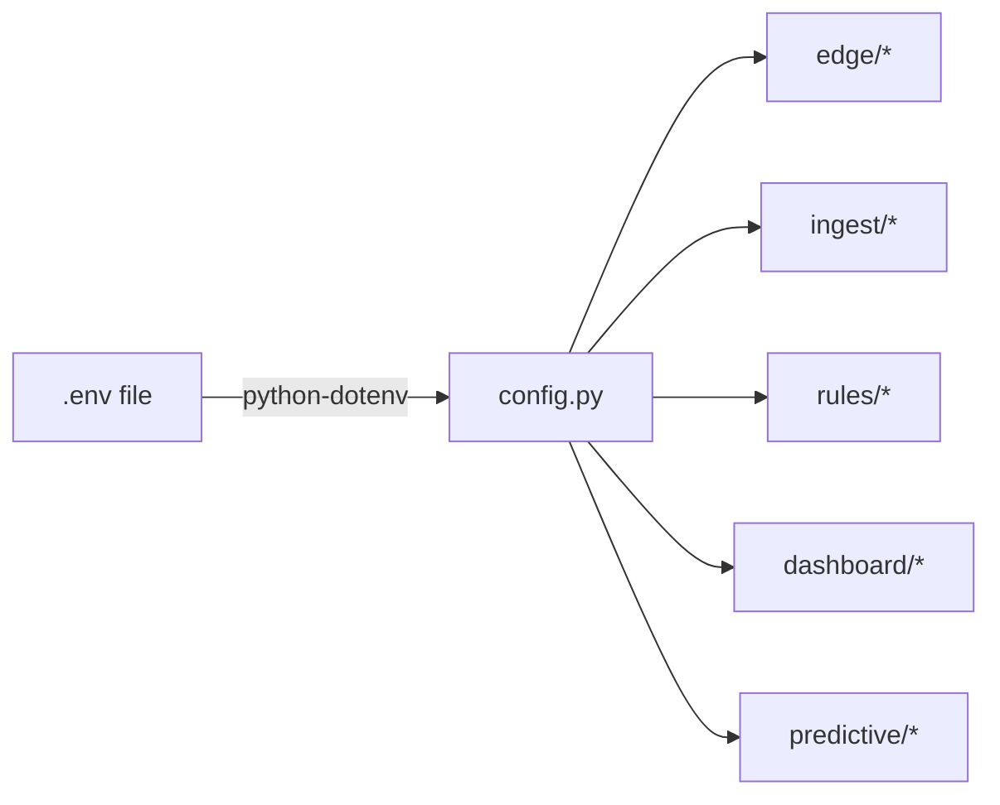

**Configuration domains:**

| Domain | Constants | Design Purpose |
|--------|-----------|----------------|
| MQTT | `MQTT_BROKER_HOST`, `_PORT`, `_CLIENT_ID`, `_QOS=1`, `_KEEPALIVE=60` | QoS 1 = at-least-once; TSDB handles dedup |
| TimescaleDB | `TSDB_HOST`, `_PORT`, `_DB`, `_USER`, `_PASSWORD`, `_CHUNK_INTERVAL="7 days"` | Singleton engine with pool_size=5 |
| Polling | `POLL_ELECTRICAL_INTERVAL=15s`, `POLL_PHYSICAL_INTERVAL=60s` | Matches physics: electrical fast, mechanical slow |
| Site | `SITE_ID="pune-isbm"`, `CONTRACTED_DEMAND_KVA=500` | No hardcoded site values anywhere else |
| NTP | `NTP_SERVER`, `_DRIFT_THRESHOLD_S=5.0`, `_CHECK_INTERVAL_S=60` | <5s drift is the hard requirement |
| Offline Buffer | `BUFFER_DB_PATH`, `_MAX_AGE_DAYS=7`, `_MAX_SIZE_MB=100`, `_DRAIN_BATCH_SIZE=50` | SQLite WAL mode for concurrent R/W |
| MD Risk Rule | `MD_WINDOW_MINUTES=15`, `MD_ALERT_MINUTE=11` | 4 min lead time before billing lock-in |
| Lazy-Idle Rule | `LAZY_IDLE_RULE_CURRENT_A=0.65`, `_TEMP_C=25.0`, `_DURATION_MIN=15` | Physics-based, distinct from dashboard threshold |
| Pressure Rule | `PRESSURE_DECAY_THRESHOLD_BAR_PER_MIN=0.15`, `_SLOPE_WINDOW_S=300` | Slow-trend detection |
| Vibration Rule | `VIB_ZONE_B_BOUNDARY=2.8`, `_C=7.1`, `_D=18.0` (mm/s RMS) | ISO 10816-3 Class II |
| Dashboard | `DASHBOARD_REFRESH_S=30`, `MD_PENALTY_RATE_PER_KVA=350.0`, `DASHBOARD_IDLE_CURRENT_THRESHOLD_A=5.0` | Dashboard gauge ≠ rule threshold (by design) |
| Alert Routing | `ALERT_ROUTING_ENABLED`, `ALERT_WEBHOOK_URL`, `ALERT_EMAIL_RECIPIENT_MAP` | Persona-based routing |

> **Critical design decision:** The dashboard idle threshold (`5.0 A`) is intentionally different from the rule engine's lazy-idle threshold (`0.65 A`). The gauge measures "motor electrically idle for the Owner overview"; the rule measures "lazy-idle onset for Layer 3 event detection". These must NOT be unified.

### 2.2 Edge Node Configuration (`edge_nodes.json`)

A JSON document validated against `schemas/edge_config_schema.json` that describes every physical node and device on-site:

```json
{
  "site": { "site_id": "pune-isbm", "contracted_demand_kva": 500, "utility": "MSEDCL" },
  "gateway": { "hardware": "Teltonika RUT956", "protocol": "modbus_rtu", "baud_rate": 9600 },
  "nodes": {
    "compressor-01": {
      "equipment_class": "rotary_screw_compressor",
      "rated_kw": 37,
      "devices": [
        { "device_id": "pune-comp-mfm384", "sensor_type": "electrical", "modbus_slave_address": 1, "poll_interval_s": 15 },
        { "device_id": "pune-comp-vib01",  "sensor_type": "vibration",  "modbus_slave_address": 10, "poll_interval_s": 60 },
        { "device_id": "pune-comp-wika01", "sensor_type": "pressure",   "modbus_slave_address": 20, "poll_interval_s": 60 }
      ]
    }
  }
}
```

The `EdgeConfig` class parses this and exposes:
- `get_node_ids() → list[str]`
- `get_devices_for_node(node_id) → list[dict]`
- `site_id → str`

### 2.3 Layer 0 Priors (`layer0_priors.yaml`)

Equipment-class population baselines for the PdM pipeline:

```yaml
equipment_classes:
  rotary_screw_compressor:
    signals:
      current_a_avg:
        mean: 0.001
        std: 0.005
        direction: "up"         # rising slope = degradation
      rms_velocity_mms:
        mean: 0.002
        std: 0.008
        direction: "up"
    health_index:
      z_scale: 15               # 1σ deviation → 15-point HI drop
      slope_window_days: 7
      risk_tiers: { high: 40, medium: 70, low: 100 }
```

---

## 3. Layers 1–2 — Edge: Sense + Connect

### 3.1 MQTT Topic Contract (`topics.py`)

```
omniview/{site_id}/{node_id}/{sensor_type}       ← Sensor data
omniview/{site_id}/_status/{node_id}              ← Device heartbeat
omniview/{site_id}/_alerts/{alert_type}           ← Rule engine events
```

**7 sensor families (frozen set):** `electrical`, `vibration`, `thermal`, `pressure`, `gas`, `stroke`, `ambient`

Key types:
- `ParsedTopic(site_id, node_id, sensor_type)` — NamedTuple from `parse_topic()`
- `build_topic()`, `build_alert_topic()`, `build_wildcard()` — constructors

### 3.2 Sensor Source Protocol & Poller Architecture

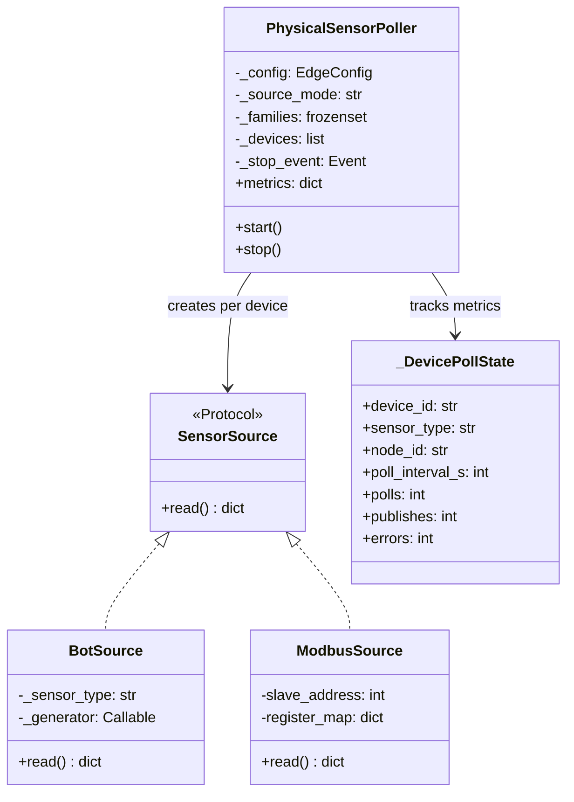

**Threading model:** One `threading.Thread` per node (not per device). All devices on the same node share one poll loop, sleeping for the shortest interval. This mirrors the physical RS-485 bus where all devices on a node share one serial connection.

**Day-1 / Hardware cutover pattern:**
- `--mode bot` → `BotSource` wraps DevB generators (synthetic data)
- `--mode modbus` → `ModbusSource` reads real Modbus RTU registers
- Cutover = swap one argument. Zero code changes to the poller, MQTT, or downstream.

### 3.3 MQTT Client Architecture (`mqtt_client.py`)

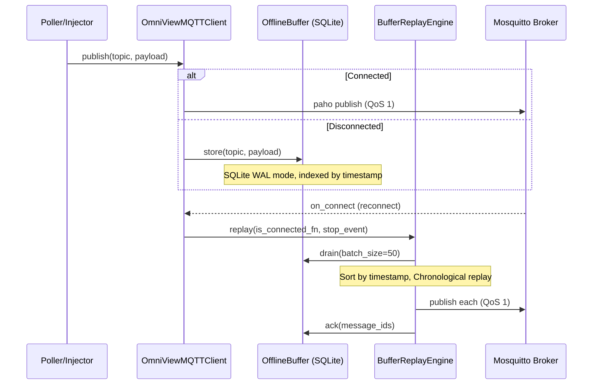

**Key design decisions:**
1. **QoS 1 (at-least-once)** — duplicates handled by TSDB's `ON CONFLICT DO NOTHING`
2. **MQTTv5 protocol** with `paho-mqtt v2 CallbackAPIVersion.VERSION2`
3. **Exponential backoff** on disconnect: starts at 1s, caps at 60s
4. **Context manager** support: `with OmniViewMQTTClient() as client:`
5. **Offline buffer drain** starts automatically on reconnect via `_on_connect` callback

### 3.4 Offline Buffer (`offline_buffer.py`)

```
SQLite Database (WAL mode)
┌──────────────────────────────────────────────┐
│ buffered_messages                            │
├──────────────────────────────────────────────┤
│ id          INTEGER PRIMARY KEY AUTOINCREMENT │
│ topic       TEXT NOT NULL                     │
│ payload     TEXT NOT NULL (JSON string)       │
│ timestamp   REAL NOT NULL (telemetry ts)      │
│ created_at  REAL NOT NULL (buffer insert ts)  │
├──────────────────────────────────────────────┤
│ INDEX idx_buffer_ts      ON (timestamp)       │
│ INDEX idx_buffer_created ON (created_at)      │
└──────────────────────────────────────────────┘
```

**API surface:**
- `store(topic, payload, timestamp)` — insert
- `drain(batch_size) → list[BufferedMessage]` — oldest-first retrieval
- `ack(message_ids)` — delete after successful publish
- `purge_expired(max_age_days) → int` — retention cleanup
- `count() → int`, `size_bytes() → int` — metrics

### 3.5 NTP Drift Guard (`ntp_guard.py`)

Monitors edge clock drift against `pool.ntp.org`. If drift exceeds 5s, all sensor readings are tagged with a drift warning, because a 30s drift would misalign the 15-minute MD billing window against MSEDCL's meter clock, invalidating demand-penalty predictions.

Returns `DriftStatus(offset_s, is_acceptable, check_time, server)`.

### 3.6 Anomaly Detector (`anomaly_detector.py`)

A self-calibrating, zero-dependency statistical engine operating at the edge (polling-interval scale):

| Method | Detects | Mechanism |
|--------|---------|-----------|
| Z-Score | Spikes & sudden drops | Rolling mean/std, threshold at ±3σ |
| Slope | Gradual degradation | Linear regression over window, threshold on slope |
| CUSUM | Slow cumulative drift | Two-sided CUSUM with configurable sensitivity |

Uses `MetricWindow(size=30)` — rolling buffer per `(device_id, field_name)` pair. Requires ≥10 readings before statistics are meaningful.

---

## 4. Wire Adapter — Schema Translation Layer

### 4.1 Purpose

`adapters/wire.py` is the **single source of truth** for renaming DevB's descriptive bot field names to the short Lead/HD names consumed by Layer 3 rules and the dashboard.

> **Contract:** No field renaming is allowed anywhere else in the codebase. Run `grep -rn` to verify.

### 4.2 Field Map Structure

7 family maps with a total of ~87 field renames:

| Family | Example Rename | Fields |
|--------|---------------|--------|
| electrical | `apparent_power_kva_total` → `kva` | 25 |
| vibration | `z_axis_rms_velocity_mm_sec` → `rms_velocity_mms` | 14 |
| thermal | `present_value_pv_c` → `zone_temp_c` | 13 |
| pressure | `pressure_min_memory_bar` → `pressure_min_bar` | 12 |
| gas | `gas_concentration_ppm` → `gas_ppm` | 7 |
| stroke | `counter_value` → `cycle_count` | 10 |
| ambient | `ambient_temp_c` → `temp_c` | 6 |

**Rules:**
- Keys in the map get renamed
- Keys NOT in the map pass through unchanged (no silent drops)
- New DevB fields pass through until explicitly mapped

### 4.3 API

```python
map_fields(sensor_type: str, data: dict) → dict       # Rename data dict fields
adapt(reading: dict) → dict                             # Deep copy + rename data sub-dict
```

---

## 5. Layer 3 (Part 1) — Cloud Ingestion & Storage

### 5.1 Database Schema (TimescaleDB)

One hypertable per sensor family. All 7 tables share the same column structure:

```sql
CREATE TABLE readings_{sensor_type} (
    time        TIMESTAMPTZ    NOT NULL,
    device_id   TEXT           NOT NULL,
    site_id     TEXT           NOT NULL DEFAULT 'pune-isbm',
    data        JSONB          NOT NULL,
    schema_version TEXT        NOT NULL DEFAULT '1.0',
    scenario_label TEXT        DEFAULT NULL,
    UNIQUE (device_id, time)
);

SELECT create_hypertable('readings_{type}', 'time',
    chunk_time_interval => INTERVAL '7 days',
    if_not_exists => TRUE
);
```

**Tables:** `readings_electrical`, `readings_vibration`, `readings_thermal`, `readings_pressure`, `readings_gas`, `readings_stroke`, `readings_ambient`

**Design decisions:**
- **JSONB `data` column** — schema flexibility while DevB's 7 sensor schemas evolve
- **`device_id + time` unique constraint** — enables `ON CONFLICT DO NOTHING` for effectively-exactly-once semantics over QoS 1 at-least-once delivery
- **`scenario_label`** — tags readings from known test scenarios (idle, spike, lazy-idle) for dashboard alert feed and demo data
- **7-day chunk interval** — TimescaleDB compression and query optimization

### 5.2 Ingestion Pipeline

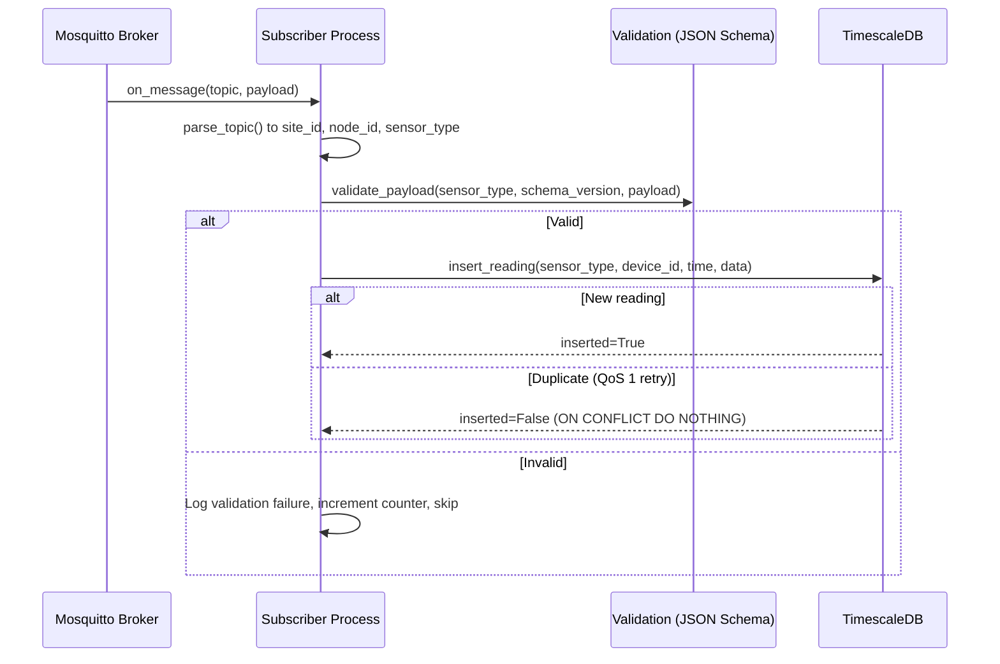

**Subscriber metrics (thread-safe counters):**
- `received`, `inserted`, `duplicates`, `errors`, `skipped_system`, `validation_failures`, `backfill_insertions`

### 5.3 Insert APIs

```python
# Single row — idempotent upsert
insert_reading(sensor_type, device_id, site_id, time, data, schema_version, scenario_label) → bool

# Bulk — multi-value INSERT for batch replay
insert_readings_batch(sensor_type, readings: list[dict]) → int

# Backfill — chunked chronological replay (OI-15)
backfill_insert(sensor_type, readings, chunk_size=100) → BackfillResult
```

`BackfillResult` tracks: `total`, `inserted`, `duplicates`, `errors`, `duration_seconds`.

### 5.4 Connection Pool

Singleton `SQLAlchemy Engine` with:
- `pool_size=5`
- `max_overflow=10`
- `pool_pre_ping=True` (verify connections before use)

### 5.5 JSON Schema Validation (`validation.py`)

Validates incoming MQTT payloads against the 7 DevB sensor schemas in `schemas/`:

| Schema File | Sensor | Required Fields (data) |
|-------------|--------|----------------------|
| `electrical_schema.json` | MFM384 | kVA, kW, PF, THD, V/I per phase, energy |
| `vibration_schema.json` | Banner Q45VT | RMS velocity (Z/X), peak accel, kurtosis, crest, surface temp, ISO zone |
| `thermal_schema.json` | Omron E5CC | PV (°C), SP, MV%, PID params, 4 alarm booleans, trend, thermal state |
| `pressure_schema.json` | WIKA A-10 | pressure_bar, min/max, setpoints, switching outputs, compressor state |
| `gas_schema.json` | Schneider HeatTag | gas_ppm, particle_idx, panel_temp, thermal_rise_rate, humidity, AQI, severity |
| `stroke_schema.json` | IFM DI5009 | switching states, counter, device_temp, operating_hrs, cycle_time |
| `ambient_schema.json` | Schneider TH110 | ambient_temp, humidity, dew_point, heat_index, RSSI |

---

## 6. Layer 3 (Part 2) — Rule Engine & Detection

### 6.1 Detector Protocol

All detectors implement a common interface:

```python
class Detector(Protocol):
    def evaluate(self, sample: dict[str, Any]) -> Event | None: ...
```

### 6.2 Detector Registry

```python
DetectorEntry(name, detector, sensor_types, enabled)
```

The `build_default_registry()` creates 8 detectors:

| Detector | Event Type | Sensor Families | Algorithm | Key Thresholds |
|----------|-----------|----------------|-----------|----------------|
| `DemandWindowDetector` | `md_risk` | electrical | Deterministic 15-min integral (mirrors MSEDCL billing) | Contract: 500 kVA, Alert at minute 11 |
| `LazyIdleDetector` | `lazy_idle` | electrical + thermal | Threshold gate: hot + no current, sustained ≥15 min | I < 0.65 A, T > 25°C |
| `PressureLeakDetector` | `pressure_leak` | pressure | Negative slope detection while compressor loaded | Decay > 0.15 bar/min over 5-min window |
| `VibrationZoneDetector` | `vibration_zone` | vibration | ISO 10816-3 Class II zone classification | Zone B: 2.8, C: 7.1, D: 18.0 mm/s |
| `GasOverheatDetector` | `gas_overheat` | gas | Multi-signal thermal rise rate + particle threshold | Severity-based |
| `EnhancedGasOverheatDetector` | `gas_overheat` | gas | Enhanced multi-axis correlation model | Statistical + physics-based |
| `StrokeJamDetector` | `stroke_anomaly` | stroke | Cycle-time deviation + production gap detection | Statistical |
| `AmbientCorrelationRule` | `ambient_correlation` | ambient | Ambient temp → cooling load → demand correlation | Correlation-based |

### 6.3 F02 — MD Risk Detector (Deep Dive)

The most critical rule — mirrors MSEDCL's own 15-minute integration exactly:

```
Per tick (≤15s cadence):
    kva = normalize(raw)
    Δt  = tick.timestamp − prev.timestamp   (minutes)
    accumulated_kva_minutes += kva × Δt

Mid-window projection:
    projected = (accumulated + kva × time_remaining) / 15

Alert condition:
    projected ≥ CONTRACTED_DEMAND_KVA  AND  T_minutes ≥ MD_ALERT_MINUTE(11)
```

**State machine per billing window:**

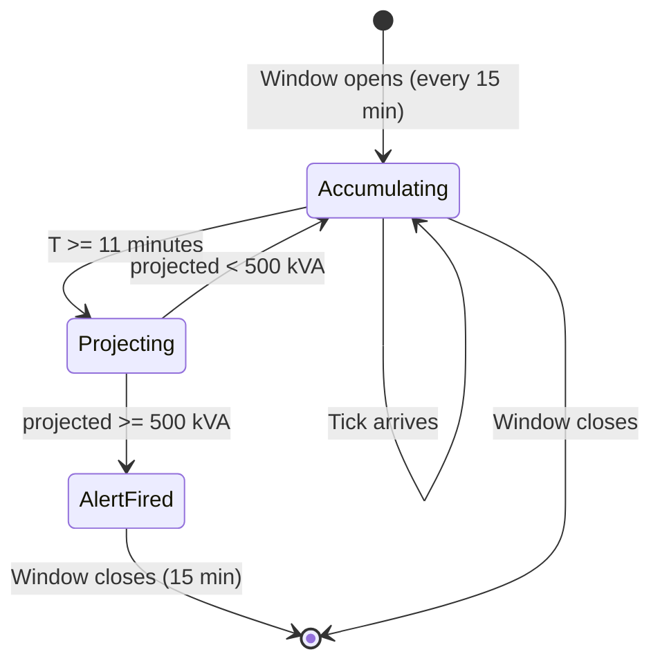

**MDRiskEvent** emits:
- `kva`, `accumulated_kva_minutes`, `projected_demand_kva`, `avg_demand_kva`
- `session_peak_demand`, `contract_demand`, `t_minutes`
- `window_start`, `window_end`, `slot_of_day`

### 6.4 F04 — Lazy-Idle Detector (Deep Dive)

```
condition = zone_temp_c > 25.0°C  AND  current_a < 0.65 A
If condition sustained ≥ 15 minutes → emit lazy_idle event
```

**Stateful tracking:** `condition_since: dict[device_id, datetime]` — per-device onset timestamp. Resets if either condition breaks.

### 6.5 F05 — Pressure Leak Detector

Detects pneumatic pressure decay while the compressor remains loaded (leak proxy):

```
slope = linear_regression(pressure_bar, last 5 minutes)
If compressor_state == "loaded" AND slope < -0.15 bar/min
    → emit pressure_leak event
```

### 6.6 F06 — Vibration Zone Classifier

Maps RMS velocity to ISO 10816-3 Class II zones:

```
Zone A (Good):       rms < 2.8 mm/s
Zone B (Acceptable): 2.8 ≤ rms < 7.1 mm/s
Zone C (Alert):      7.1 ≤ rms < 18.0 mm/s
Zone D (Danger):     rms ≥ 18.0 mm/s
```

### 6.7 DetectorsLiveRunner — The Glue Layer

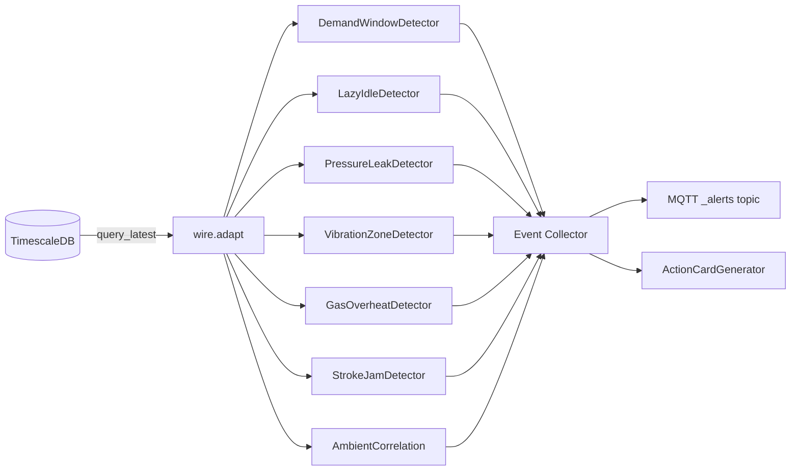

**Poll cycle (every 15s):**
1. Pull latest readings from each TSDB sensor-family table
2. Run through `wire.adapt()` for field name mapping
3. Pass each adapted sample to every registered detector matching that sensor family
4. Collect emitted events
5. Publish events to `omniview/{site}/_alerts/{event_type}`
6. Feed events to ActionCardGenerator

**Non-blocking:** Each detector runs independently — a failing detector logs an error and doesn't block others.

---

## 7. Layer 3 (Part 2) — Predictive Maintenance (PdM) Pipeline

### 7.1 Pipeline Architecture

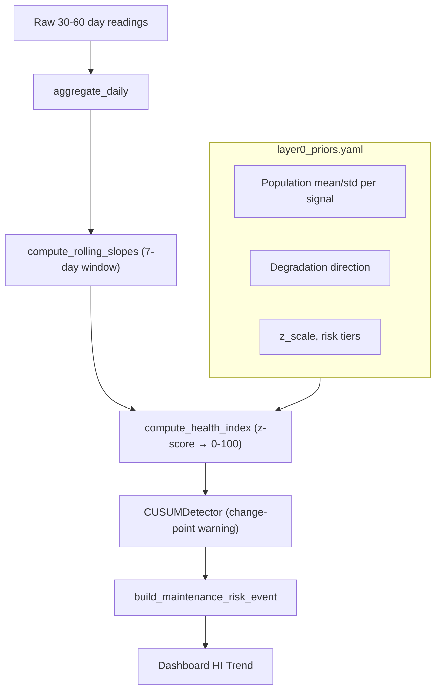

### 7.2 Health Index Formula

```
avg_z = mean(directional_z_score(slope_i, prior_i) for each tracked signal)
health_index = clip(100 - avg_z × z_scale, 0, 100)
```

Where:
- `slope_i` = 7-day trailing slope of signal i
- `prior_i` = population (mean, std) for signal i
- `z_scale = 15` → a 1σ deviation drops HI by 15 points

**Risk tiers:** `high` (HI < 40), `medium` (40 ≤ HI < 70), `low` (HI ≥ 70)

### 7.3 HealthIndexResult — Full Traceability

```python
@dataclass
class HealthIndexResult:
    machine_id: str
    date: str
    health_index: float          # 0–100
    risk_tier: str               # "low" | "medium" | "high"
    confidence_stage: str        # "stage_a_unsupervised" (always, for Stage A)
    contributing_features: list[ContributingFeature]  # per-signal breakdown
    avg_z: float
    signal_count: int
    gap_flagged: bool
```

Each `ContributingFeature` includes: `signal`, `slope_value`, `prior_mean`, `prior_std`, `z_score`, `direction`, `description`.

### 7.4 CUSUM Change-Point Detection

Two-sided CUSUM with configurable sensitivity (`h` threshold and `k` allowance):
- Detects slow cumulative drift invisible to z-score (e.g., bearing degradation over weeks)
- Emits `CUSUMAlert` when cumulative sum exceeds threshold

### 7.5 BatchResult

```python
@dataclass
class BatchResult:
    machine_id: str
    daily_rows: list[DailyRow]
    slopes: list[dict]
    hi_series: list[HealthIndexResult]
    cusum_alerts: list[CUSUMAlert]
    events: list[dict]
    latest_hi: HealthIndexResult
```

---

## 8. Action Cards — Human-Readable Recommendation Engine

### 8.1 ActionCard Dataclass

```python
@dataclass(frozen=True)
class ActionCard:
    card_id: str                   # Hash-based ID for deduplication
    timestamp: datetime
    event_type: str                # e.g., "md_nearmiss", "lazy_idle"
    severity: str                  # "CRITICAL" | "WARNING" | "INFO"
    title: str                     # One-line with icon
    summary: str                   # 2–3 sentence human explanation
    recommended_action: str        # What to do
    do_not: str                    # Anti-action (common wrong response)
    rupee_impact: str              # Financial impact in ₹
    urgency_window: str            # Time to act
    target_role: str               # Who should receive this
    device_id: str
    source_module: str             # Which detector generated this
    evidence: dict                 # Raw data backing the card
```

### 8.2 Card Templates

| Event Type | Severity | Target Role | Title Pattern | Anti-Action |
|-----------|----------|-------------|---------------|-------------|
| `md_nearmiss` | CRITICAL | plant_manager | ⚡ MD Near-Miss — Demand Approaching Limit | Do NOT shut down compressor — backup load spike |
| `lazy_idle` | WARNING | operator | 🔥 Lazy-Idle — Heater Burning While Idle | Do NOT force-cool — thermal shock risk |
| `pressure_leak` | WARNING | maintenance_engineer | 💨 Pressure Leak — Compressor Load vs Decay | Do NOT increase pressure to compensate |
| `vibration_zone_c` | WARNING | maintenance_engineer | 📳 Vibration Alert — Entering ISO Zone C | Do NOT continue operating if Zone D reached |
| `vibration_zone_d` | CRITICAL | operator | 🚨 Vibration Critical — ISO Zone D | Do NOT restart without inspection |

---

## 9. Layers 5–6 — Dashboard, Monetization & Alert Routing

### 9.1 Dashboard Architecture (Streamlit — `app.py`)

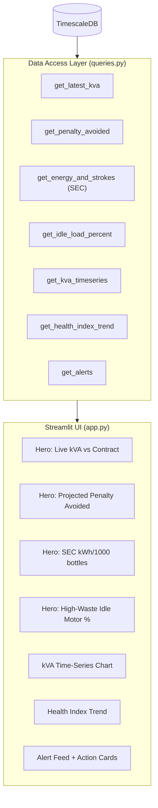

**Hero metrics (PRD §2.6):**
1. **Live kVA vs Contracted Sanctioned Demand** — `get_latest_kva()` → `md_proximity_percent`
2. **Projected Monthly Demand Penalty Avoided (₹)** — `get_penalty_avoided()` → `MD_PENALTY_RATE_PER_KVA × breach_count`
3. **Specific Energy Consumption** — `get_energy_and_strokes()` → `kWh / 1000 bottles`
4. **High-Waste Idling Motor Load %** — `get_idle_load_percent()` → readings where `current_a < 5.0 A`

### 9.2 Alert Router (`alert_router.py`)

Layer 6 persona-based routing with channel stubs:

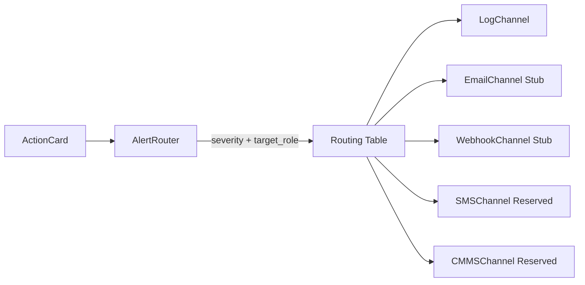

**Routing table:**

| Severity | Target Role | Channels |
|----------|-------------|----------|
| CRITICAL | plant_manager | Webhook + Log |
| CRITICAL | operator | Webhook + Log |
| WARNING | maintenance_engineer | Email + Log |
| WARNING | plant_manager | Email + Log |
| WARNING | operator | Log |
| INFO | (any) | Log |

**Channel backend protocol:**
```python
@runtime_checkable
class ChannelBackend(Protocol):
    def send(self, card: ActionCard) -> RoutingResult: ...
```

All POC channels are stubs — they log what *would* be sent. Production channels (Twilio SMS, SMTP, CMMS API) swap in with zero change to routing logic.

### 9.3 Jumbo Floor Display (`jumbo_display.py`)

Drives the Multispan RS-6006 LED display via Modbus write-back:
- Shows live kVA value
- Flashes warning pattern when approaching contract limit
- Updated from the DetectorsLiveRunner cycle

---

## 10. Data Flow — End-to-End Sequences

### 10.1 Normal Operation (Connected)

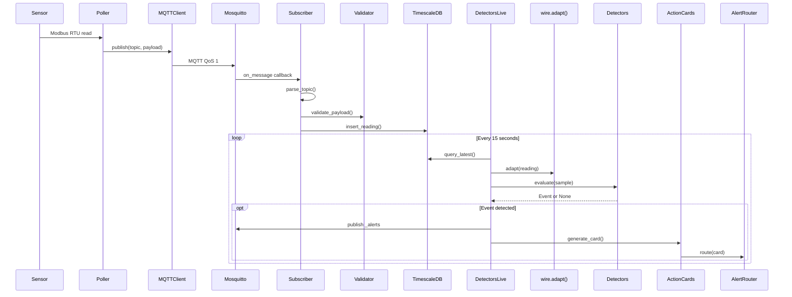

### 10.2 Offline → Reconnect (Buffer Replay)

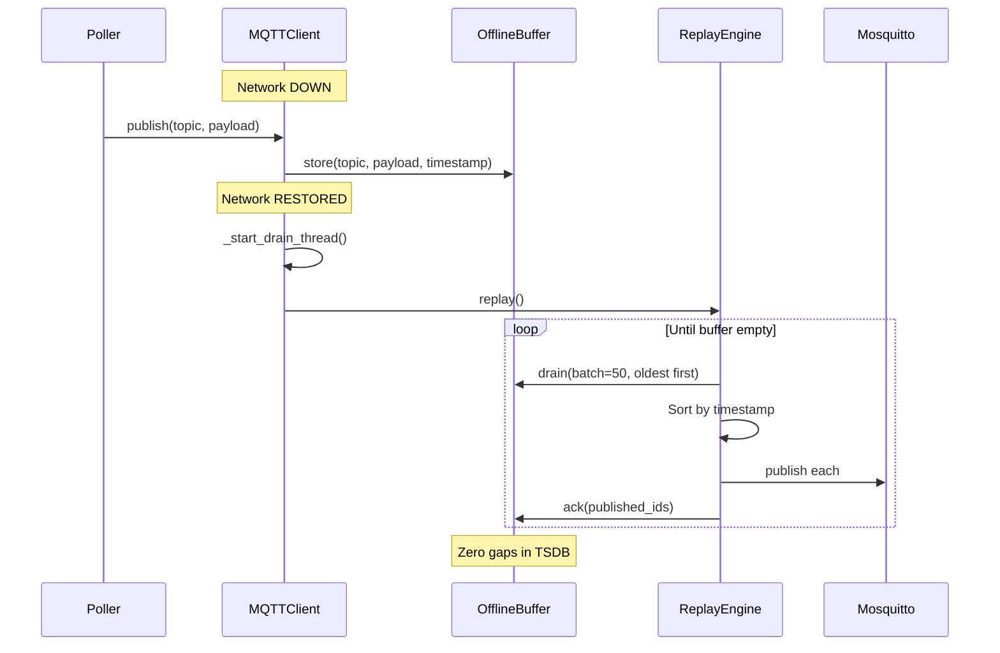

---

## 11. Infrastructure — Docker Compose Stack

```yaml
services:
  mosquitto:                    # Eclipse Mosquitto v2
    ports: [1883, 9001]         # MQTT + WebSocket
    healthcheck: mosquitto_sub connectivity test

  timescaledb:                  # TimescaleDB on PostgreSQL 16
    ports: [5432]
    environment:
      POSTGRES_DB: omniview
      POSTGRES_USER: omniview
    healthcheck: pg_isready

networks:
  omniview-net: bridge
```

---

## 12. Testing Architecture

37 test files covering all subsystems:

| Test Domain | Files | Coverage Focus |
|-------------|-------|---------------|
| Edge connectivity | `test_mqtt_client`, `test_offline_buffer`, `test_buffer_replay` | Publish, disconnect buffering, replay |
| Edge polling | `test_poller`, `test_parsers`, `test_ntp_guard` | Sensor polling, parsing, clock drift |
| Edge config | `test_device_config`, `test_site_profile`, `test_safety_signoff`, `test_install_procedure` | Config loading, site validation |
| Ingest | `test_db`, `test_tsdb_inserter`, `test_subscriber`, `test_validation`, `test_seed` | TSDB ops, schema validation, seeding |
| Adapters | `test_adapters_wire` | All 7 family field maps |
| Rules | `test_detectors`, `test_anomaly_detector`, `test_gas_model`, `test_gas_overheat`, `test_ambient_correlation` | All detectors |
| Action cards | `test_action_cards` | Card generation for all event types |
| Alert routing | `test_alert_router` | Routing table, channel stubs, dedup |
| Dashboard | `test_dashboard_queries`, `test_jumbo_display` | Query layer, floor display |
| PdM | `test_predictive` | Priors, features, HI, CUSUM, batch |
| E2E | `verify_e2e_mqtt_pipeline`, `e2e_gas_model_live_test` | Full pipeline validation |

---

## 13. Cross-Cutting Concerns

### 13.1 Error Handling Philosophy

- **Edge:** Sensor read failures → log + increment error counter → continue polling other devices. Never crash the poller.
- **MQTT:** Disconnections → automatic offline buffering. Malformed messages → log + skip.
- **Subscriber:** Invalid payloads → validation failure counter + skip. Never crash the bridge.
- **Detectors:** Each detector runs independently — a failing detector logs and doesn't block others.
- **Action cards:** Every card must be fully populated. No TBD or placeholder fields in client-facing output.

### 13.2 Idempotency

```
QoS 1 (at-least-once delivery) + ON CONFLICT DO NOTHING (unique on device_id + time)
= Effectively-exactly-once semantics
```

### 13.3 Timestamp Discipline

- All timestamps are UTC internally, IST (`UTC+05:30`) only at the presentation layer
- NTP sync at the edge with <5s drift tolerance
- Timestamps extracted from payloads in priority: `ISO 8601 string > epoch float > arrival time (fallback)`
- Late/backfilled readings insert at their correct historical position — TimescaleDB handles out-of-order writes natively

### 13.4 Logging

`Python logging` throughout (no `print` statements in production code). Format:
```
%(asctime)s [%(name)s] %(levelname)s: %(message)s
```

### 13.5 Security (POC Scope)

- MQTT: Plain TCP on port 1883 (TLS on 8883 reserved for production)
- TimescaleDB: Password in `.env`, not committed (`.gitignore`)
- No authentication layer on the Streamlit dashboard (POC scope)
- No auto-actuation — human-in-the-loop only

---

## 14. Key Design Decisions & Rationale Summary

| # | Decision | Rationale | Source File |
|---|----------|-----------|------------|
| 1 | One table per sensor family | Query perf + matches DevB's 7-schema contract | `db.py` |
| 2 | JSONB data column | Schema flexibility while DevB schemas evolve | `db.py` |
| 3 | Wire adapter as single rename point | Prevents scattered field mappings; grepable | `wire.py` |
| 4 | Dashboard threshold ≠ Rule threshold | Different purposes: overview vs detection | `config.py` |
| 5 | One thread per node, not per device | Mirrors physical RS-485 bus topology | `poller.py` |
| 6 | Deterministic integral for MD (no ML) | Must match MSEDCL billing exactly | `demand_window.py` |
| 7 | Threshold-based lazy-idle (no ML) | Physics unambiguous: heat + no current = waste | `lazy_idle.py` |
| 8 | Z-score HI (no supervised ML Stage A) | No logged failure data; unsupervised by design | `health_index.py` |
| 9 | Bot/Modbus swap via CLI arg | Hardware cutover = one argument, zero code changes | `poller.py` |
| 10 | Channel stubs with Protocol interface | Production channels swap in with zero routing changes | `alert_router.py` |
| 11 | Action cards never auto-actuate | Human-in-the-loop is a safety constraint | PRD §2.3 |
| 12 | SQLite WAL for offline buffer | Concurrent reads/writes from poller + drain threads | `offline_buffer.py` |

---

*This document was generated from a complete source-code inspection of the `omniview-iq-poc` repository. Every class, function, constant, and design decision referenced above is traceable to a specific source file.*
